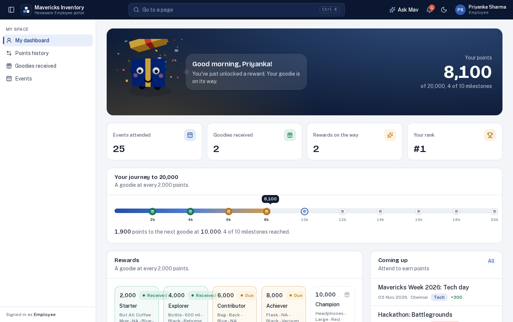

# Mavericks Inventory

Stock management and employee engagement for the Mavericks team. Executives record the goodies, welcome kits, T-shirts and event merchandise that come in and go out, a manager approves it, and only then does the stock count change. Employees earn points for every event they attend, get a goodie at every 2,000 points up to 20,000, and see their progress in their own portal. Every movement is on a ledger, and every change is in the audit log.

It replaces the Stock count / Recipient / Procurement Excel trackers, and those sheets upload into it without reformatting.




**Guides**

- **[User guide](docs/USER-GUIDE.md):** every screen and button, with pictures, for people who'll use the app
- **[Setup and deployment](docs/SETUP-AND-DEPLOYMENT.md):** database setup, Vercel, AWS, Azure or your own server, company single sign-on, backups, troubleshooting

**Put a demo online in about 10 minutes, without touching a database:** [Vercel + Neon steps](docs/SETUP-AND-DEPLOYMENT.md#6a-vercel--neon), or

[](https://vercel.com/new/clone?repository-url=https%3A%2F%2Fgithub.com%2Fvenkynani1%2Fmavericks-inventory&project-name=mavericks-inventory&repository-name=mavericks-inventory&env=AUTH_SECRET,SEED_DEMO_DATA,DEMO_MODE&envDescription=AUTH_SECRET%3A%20any%20random%20text%20of%2032%2B%20characters.%20SEED_DEMO_DATA%20and%20DEMO_MODE%3A%20true%20for%20a%20demo%20with%20sample%20data%2C%20false%20for%20production.&stores=%5B%7B%22type%22%3A%22integration%22%2C%22integrationSlug%22%3A%22neon%22%2C%22productSlug%22%3A%22neon%22%2C%22protocol%22%3A%22storage%22%7D%5D)
- **[BRD traceability](docs/BRD-TRACEABILITY.md):** where each requirement in the BRD is met
- **[Demo script and roles guide](docs/DEMO-SCRIPT.md):** a 25-minute walkthrough of every role and process, with what to click and what to say
- **[Test plan](docs/TEST-PLAN.md):** automated checks, 20 real-world UAT scenarios, edge cases and a sign-off sheet

## What it does

- **Executives** add stock items, record distributions and stock inward one at a time or by uploading Excel (up to 50,000 rows), and submit them for approval. Valid rows become a draft; problem rows come back in a downloadable error report.
- **Managers** approve or return requests at level 1. **The Management Authority** approves at level 1 or gives the final level-2 approval when two levels are switched on.
- **System Administrators** add users and set roles, choose one or two approval levels (optionally only above a unit threshold), and maintain the categories, purposes, locations and units.
- **Home:** a worklist of what needs you (overdue approvals, returned requests, low stock, rewards due), number tiles with trends (on hand, reserved, free to promise, handed out, low or out, event points), engagement snapshot, charts, items to restock and size runs.
- **Inventory like large stores teams run it:** on hand, reserved and free-to-promise per item, days of cover, a stock movements ledger, and cycle counts whose differences go through approval.
- **Engagement:** events (tech, non-tech, workshops, hackathons, codeathons…) with points per type set by the administrator; attendance by pasting IDs or uploading a sheet; points credited instantly; a reward at every 2,000 points up to 20,000; rewards handed out through a normal approved distribution; adjust and reset with reasons; a leaderboard.
- **Employee portal:** each employee sees their own points, a progress track to 20,000 with a gift at every milestone, rewards, goodies received and events.
- **Ask Mav:** an assistant in the top bar that answers questions from live data, limited to what the person's role may see. Works out of the box; uses an AI model when a key is set: free Gemini (`GEMINI_API_KEY`) or Groq (`GROQ_API_KEY`), or Claude (`ANTHROPIC_API_KEY`).
- **One-click demo sign-in** and a 3D gift-box mascot that says hello.
- **Notifications** bell, **system status** page (regions and database latency) and engagement reports.
- **Reports:** current stock availability, distributed stock, pending approval, approval history and the stock movement ledger, each exportable to Excel and PDF.
- **Company single sign-on** (Microsoft Entra ID or any OpenID Connect provider), built in and off until configured; roles come from Entra app roles.
- Ctrl+K search, light and dark themes, phone layout.

## Rules the app enforces

| Rule | How |
| --- | --- |
| Stock changes only at final approval; drafts, requests in review and returned requests never touch it | Quantities are posted in the same database transaction as the final approval, together with the ledger entries |
| A distribution can't exceed what's on the shelf (switchable by an admin) | Checked on submit, then again at approval with a conditional update under a row lock, so two approvals at the same moment can't hand out the same units |
| Nobody approves their own request; the two levels are signed by different people | Checked on the server for every approval, single or bulk |
| Level 1 is a Manager or the Management Authority; level 2 is the Management Authority only | Role check per level; the number of levels is fixed when the request is submitted |
| Returning a request needs a reason | Remarks are required; the executive sees them and can fix and resubmit |
| Only drafts and returned requests can be edited, and only by their creator | Checked on every edit; quantities on approved items change only through new requests |
| Submitted and approved records are never deleted | Drafts are marked deleted and items deactivated; approval history and the ledger are insert-only; lines removed from a draft and every edit are kept in the audit log with before/after values |
| Stock codes are unique; uploads reject duplicates within the file and against the database | Database unique key plus upload validation |
| A one-time password must be replaced before anything else | Users with one are held on the profile page until they choose their own |
| Sign-in is throttled | 5 wrong passwords lock that email for 5 minutes |
| Company sign-in is verified end to end | Code flow with PKCE, state and nonce; ID-token signature, issuer and audience checked against the provider's keys; people without an app role are refused |
| API errors have one shape | `{ "error": { "code": "NOT_FOUND", "message": "…" } }` |

## Try it: demo script

With the demo data loaded (`npm run db:seed`), the sign-in page shows **Explore the demo**: select a role to sign in with one click (password `Mavericks@2026` if you type it).

1. Sign in as the **Executive**. **Distributions → Record a distribution**: pick *Bluetooth Speaker*, quantity 2, a recipient, **Submit for approval**. Open **Stock → Bluetooth Speaker**: the available number hasn't changed yet.
2. Try a quantity of 100000: the item turns red and **Submit** is disabled.
3. Sign in as the **Manager** (another browser or a private window). **Approvals** → open the request → **Approve and update stock**. The speaker's available count drops by 2 and the ledger shows the movement.
4. As the Executive, record another distribution. As the Manager, **Reject** it with a remark. As the Executive, open it, fix a line, **Resubmit**. The approval history shows every step.
5. As the Executive, **Stock → Add item** with an opening quantity of 150 and submit. Because it's over 100 units, the demo rules need two levels: the Manager approves level 1, then the **Management Authority** approves level 2 and the item appears in stock.
6. **Distributions → Upload Excel** with an old Recipient sheet. Good rows become a draft; download the error report for the rest.
7. **Reports**: download any report as Excel or PDF.
8. Sign in as the **Admin**: add a user, sign in as them with the one-time password, and choose a new password. Open **Points and rewards rules** and change the points for workshops or the goodie for a milestone.
9. As the **Executive**, open **Events → New event** (a workshop), then paste a few employee IDs (for example `2000149999`). Points are credited and anyone crossing 2,000 points appears in **Rewards**. Select them and **Create distribution and submit**; the Manager approves and the rewards show as issued.
10. Sign in as the **Employee** (Priyanka Sharma): her points, the progress track to 20,000 and her goodies. Select **Ask Mav** and ask "How many points do I have?".

The same script runs automatically as an end-to-end test (`npm run e2e`, 62 checks in a real browser; `npm test` runs 23 unit tests) on every push.

## Run it on your computer

Requirements: Node.js 20+ and PostgreSQL 14+ (or Docker).

```bash
git clone https://github.com/venkynani1/mavericks-inventory.git
cd mavericks-inventory
npm install
cp .env.example .env          # set DATABASE_URL, DIRECT_URL and AUTH_SECRET; DEMO_MODE="true" to list demo accounts
npx prisma migrate deploy     # create the tables
npm run db:seed               # demo data; or `npm run db:setup` for an empty production-style start
npm run dev                   # http://localhost:3000
```

Or everything in containers: `docker compose up -d --build` (see the notes at the top of `docker-compose.yml`).

**Production start without demo data:** set `BOOTSTRAP_ADMIN_EMAIL` and `BOOTSTRAP_ADMIN_PASSWORD`. While there are no users, signing in with those creates the first System Administrator, who must then choose a new password. Full steps are in the [setup guide](docs/SETUP-AND-DEPLOYMENT.md#5-load-data-production-or-demo).

### About the demo data

- The 43 items and their procured, distributed and available quantities come from *Updated stock details – Sep 25*, and the stock balances reconcile exactly with the ledger.
- Past handovers are regenerated to match each item's distributed quantity using **made-up names and IDs**; no real employee data is in this repository.
- The Sep 25 sheet shows *Plastic Pin Badges* as 1,000 procured, 0 available and none distributed. The demo loads the 1,000; that gap needs checking against the physical stock.
- The new items from the *Apr 26* tracker (RGB headphones, wireless mouse, laptop stickers, black coffee mug) are a request waiting for approval.

## Checks

| Command | What it does |
| --- | --- |
| `npm run typecheck` | TypeScript |
| `npm run lint` | ESLint |
| `npm run build` | Production build |
| `npm run e2e` | Every role and flow in a headless browser against a running app with demo data (`npx playwright install chromium` once) |
| `npm run screenshots` | The same run, also refreshing `docs/screenshots` (use a freshly seeded database) |
| `npm run mock-sso` / `npm run sso-check` | A test identity provider, and 15 checks of company sign-in against it ([setup guide §13.7](docs/SETUP-AND-DEPLOYMENT.md#137-try-it-without-azure-mock-provider)) |

GitHub Actions (`.github/workflows/ci.yml`) runs all of them, including the SSO checks, on every push against a real PostgreSQL. Run it manually with **screenshots** ticked to get fresh screenshots as a download. To test a live deployment, run **Actions → Check a deployed site** with its address.

## Other commands

| Command | What it does |
| --- | --- |
| `npm run db:deploy` | Apply new database migrations (safe on live data) |
| `npm run db:setup` | Create the standard lists and approval rules, no demo data |
| `npm run db:seed` | Load demo data into an empty database |
| `npm run db:migrate` | Create a migration after changing `prisma/schema.prisma` (development) |
| `npm run db:reset` | Delete everything and reload demo data (development only) |
| `npm run db:studio` | Browse the database |

## Project layout

```
prisma/schema.prisma        Database model: stock items, requests, lines, approvals, ledger, audit log, users, settings
prisma/migrations/          Database migrations (applied with prisma migrate deploy)
prisma/base-data.ts         Standard lists and default approval rules
prisma/setup.ts · seed.ts   Production setup · demo data (from the Sep 25 tracker)
src/middleware.ts           Sends signed-out visitors to /login; security headers
src/app/(app)/              Signed-in pages: overview, stock, distributions, stock inward, requests, approvals, reports, admin, profile
src/app/login/              Sign-in
src/app/api/                Excel uploads and templates, report exports, request export, error reports, health check
src/app/actions/            Server actions: stock, requests and approvals, admin, sign-in, search
src/lib/server/workflow.ts  Approval engine: submit, approve, reject, stock posting, availability checks
src/lib/server/imports.ts   Excel validation for stock, distribution and stock inward uploads
src/lib/server/reports.ts   The five reports; pdf.ts and excel.ts write the files
src/lib/roles.ts            Roles and what each may do
src/components/app/         App components (size runs, stock gauge, approval queue, upload flow…)
src/components/ui/          shadcn/ui building blocks
scripts/e2e.mjs             End-to-end test and screenshot capture
docs/                       User guide, setup and deployment guide, BRD traceability, screenshots
```

Built with Next.js 15, TypeScript, PostgreSQL with Prisma 6, shadcn/ui on Radix with Tailwind CSS 4, ExcelJS and jsPDF. Sign-in uses bcrypt password hashes and a signed, http-only session cookie.

## Later

- **Email notifications** to approvers when a request is submitted, and to the executive when it's returned.
- **Stock adjustments** for damaged or lost items, using the existing `ADJUSTMENT` ledger type.
