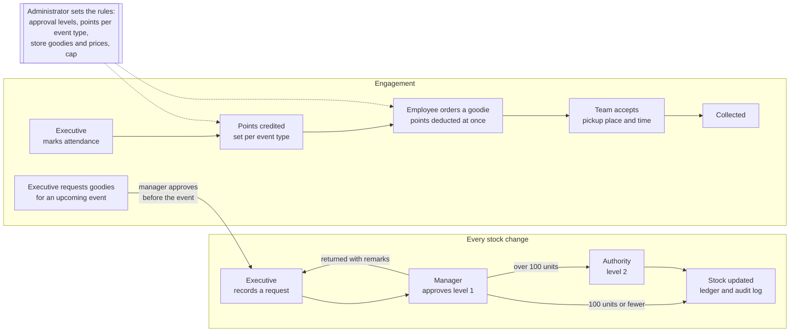

# Mavericks Inventory: demo script and roles guide

A 25-minute walkthrough of every role, in the order the work actually flows: stock comes in, goodies go out with approval, goodies for an event are approved before it, employees earn points at events, and they spend those points in the points store.

**Contents:** [Before you start](#before-you-start) · [The five roles](#the-five-roles) · [How the processes connect](#how-the-processes-connect) · [Part 1, Executive](#part-1-executive-stock-and-a-distribution) · [Part 2, approvals](#part-2-manager-and-management-authority-approvals) · [Part 3, engagement](#part-3-executive-event-goodies-attendance-and-prizes) · [Part 4, Employee](#part-4-employee-the-portal) · [Part 5, Administrator](#part-5-administrator-rules-users-audit-system-status) · [Audience questions](#questions-the-audience-may-ask)

## Before you start

- **Link:** [mavericks-inventory-nu.vercel.app](https://mavericks-inventory-nu.vercel.app). The sign-in page shows **Explore the demo** with one button per role. One click signs you in; no typing.
- **Two browser windows:** open a normal window and a private (incognito) window side by side. Sign in as the maker (Executive) in one and the checker (Manager) in the other, so the audience sees a request leave one person and arrive with the other.
- **Switching roles:** your name at the top right, then **Sign out**, then pick the next role.
- **Password**, if anyone types it: `Mavericks@2026` for every demo account.
- **Timing:** about 25 minutes. Parts 1 and 2 take 8 minutes, Part 3 takes 7, Parts 4 and 5 take 5 each.
- **Data:** names and numbers are sample data. If a request mentioned below was already approved during practice, use any other request in the same list.

## The five roles

The app splits the work so that no one person can both request and approve stock: the maker-checker rule auditors look for.

| Role | Demo person | Does | Can't do | Lands on |
| --- | --- | --- | --- | --- |
| **Executive** (maker) | Kavin Raj | Adds stock items, records distributions, stock inward and stock counts, creates events, requests goodies before events, marks attendance, records winners, accepts store orders and sets the pickup | Approve anything | Home with the to-do list |
| **Manager** (checker, level 1) | Rahul Iyer | Approves or returns requests; sees stock, events, points, reports and the audit log | Create requests; approve their own | Home, then Approvals |
| **Management Authority** (level 2) | Meera Krishnan | Gives the final approval on large requests (over 100 units in the demo) | Approve both levels of the same request | Approvals |
| **Administrator** | Sanjana Rao | Users and roles, approval rules, points per event type, the points store (goodies and their points prices), adjusting or resetting points, master lists, audit log, system status | Create or approve requests | Home |
| **Employee** | Priyanka Sharma | Sees only their own points, orders goodies from the points store, sees where to collect them, goodies received and events | See stock, other people or any staff page | My dashboard |

Three rules hold for everyone: stock changes only at final approval; nobody approves their own request; every points change carries a reason and stays in the history.

## How the processes connect

The top row is every stock change: the executive makes it, a manager (and for large requests the authority) checks it, and only then does stock move. Goodies for an event go through that same check, before the event. The bottom row is engagement: attendance earns points, and employees spend them in the points store; the team accepts the order and tells them where and when to collect.

## Part 1, Executive: stock and a distribution

Point to make: an executive records everything, but nothing leaves the shelf until a manager says yes.

1. Sign in as **Executive**. **Say:** "The top bar is the same for everyone: search and the bell. The left menu is grouped by the kind of work, and each role sees only what it needs."
2. On **Home**, point at **Needs your attention** (the Fusion report due in 2 days, store orders, events without goodies) and the tiles: **Procured**, **In stock** and **Distributed**. Open **Stock by product** and expand **Back Bag**: "Black and blue bags are added together; the colours are inside." **Say:** "Low stock, anything under 50, is on the stock list's Low tab, not cluttering Home."
3. **Items** (menu, Inventory). Show the **Low** tab, then the columns **Reserved**, **Free to promise** and **Cover** (days the stock lasts at the last 90 days' pace). **Say:** "This is how large stores teams track stock: not just what's on the shelf, but what's already promised."
4. Open **Bluetooth Speaker**. Note the **Available** number. Show the movement ledger and recipients.
5. **Distributions → Record a distribution.** Title "Speaker giveaway", item *Bluetooth Speaker*, quantity 2, a recipient name and employee ID. Select **Submit for approval**.
6. Go back to the speaker: **Available hasn't changed.** **Say:** "It's reserved, not gone. Stock moves only on approval."
7. Optional: try quantity 100000. The line turns red and Submit is blocked: you can't give away stock you don't have.
8. Optional: **Distributions → Upload Excel** to show that the old Recipient sheet uploads as it is; bad rows come back in an error report.
9. Optional: **Stock counts → New count.** Type a count one lower than the system for an item, choose the reason "Damaged", submit. Only differences go for approval.

## Part 2, Manager and Management Authority: approvals

Point to make: the checker sees everything needed to decide, every decision is recorded, and big requests need two different people.

1. In the private window, sign in as **Manager**. The bell and the **Approvals** badge show requests waiting; overdue ones (older than 48 hours) are flagged red.
2. Open **Approvals**, then the "Speaker giveaway" request. Show the lines, the stock check, and that there's no edit button: the manager can only approve or return.
3. Select **Approve and update stock**, add a remark, confirm. Switch to the Executive window and refresh the speaker: **Available dropped by exactly 2**, and the ledger shows who approved it.
4. **Return with remarks:** open another waiting request (for example "Intern welcome, batch 14"), select **Reject**, write "Please split by location". Sign in as Executive, open **My requests**: the remark is shown; the executive edits and resubmits. The approval history lists every step.
5. **Two levels:** open a large request (for example "New goodies for April onboarding", 970 units). The Manager approves level 1; it then waits for level 2. Sign in as **Management Authority** and give the final approval. **Say:** "Above 100 units the rules need two signatures from two different people. The admin sets that threshold."
6. Optional: tick several requests in **Approvals** and approve them together.
7. **Reports** (menu, Analytics): open **Distributed stock**, select **Excel** or **PDF**. **Say:** "Reports read only approved records, so they always match the ledger."

## Part 3, Executive: event goodies, attendance and prizes

Point to make: goodies for an event are approved before it happens, attending events earns points instantly, and prizes come out of the goodies already approved.

How points work: each event type is worth a fixed number of points that the admin sets (tech talk 200, webinar 150, tech event 300, workshop 400, codeathon 500, hackathon 600, non-tech event 100, leadership connect 150, CSR activity 250). Points go up to 20,000. Employees spend them in the points store (Part 4).

**Goodies before the event:**

1. Sign in as **Executive**. On **Home**, point at **Upcoming events without goodies approved** in the to-do list.
2. Open **Events → Upcoming** and an upcoming event (for example **Mavericks Week 2026: Tech day**). Its **Event goodies** panel already shows a request waiting for the manager.
3. Open another upcoming event, select **Request goodies**: *Plastic Pin Badges* 50 and *Bluetooth Speaker* 1. Select **Send for approval**. **Say:** "Goodies for an event are approved before the event. There's no point approving after they're handed out."
4. As **Manager**, open **Approvals**: the row says **For an event on (date): approve before it**. Approve it. Back as Executive, the speaker's **Available** dropped by 1 and badges by 50: the stock moved at approval, before the event.
5. Point out: requests for an event that has already happened are refused, and a request still waiting when the date passes is flagged **Event passed**.

**Vouchers before the event:** in the same **Request goodies** dialog, **Add vouchers**: value ₹5,000, how many 2. **Say:** "We don't know the winners yet, so the manager approves the number and value now; names are added after the event."

**QR goodies desk (at the event):**

- On **Hackathon: Agentic AI** (or any event with approved goodies), select **Goodies desk (QR)**, choose *Plastic Pin Badges* and **Open desk and show QR**.
- On a phone, scan it: enter `2000149999` and "Priyanka". **Say:** "No sign-in and no Excel: the ID is checked against the Fusion report, one per person." The phone says **Show this screen at the desk**.
- On the laptop, Priyanka appears under **Waiting at the desk**. Select **Hand over**. The phone changes to **Enjoy your goodie!**, she's marked present, and it shows in her portal under Goodies received.

**Weekly Fusion report:** open **Employees and points**. The banner shows the last upload and that the next is due in 2 days (the bell says so too). **Upload Fusion report** takes the Fusion Connect export as is. **Say:** "Only active employees earn points or get goodies; resigned people are marked from the DHR Status column." Point at the **Fusion status** and **Goodies received** columns, and **Export** (Excel has a Goodies received column).

**Attendance and points:**

6. **New event:** name "Cloud workshop: Terraform basics", type **Workshop (400 pts)**, today's date. Select **Create event**.
7. Under **Mark attendance**, paste `2000149999, 2000150001, 9999999990` and select **Mark 3 present**. The result shows 2 marked (+400 each) and 1 ID not found. Paste the same IDs again: they're skipped as **already marked**. **Say:** "You can also upload the attendance sheet from Teams or the registration form."
8. Open **Employees and points**, then Priyanka Sharma (2000149999): current and lifetime points, rank, points history with the workshop at the top, and her store orders.
9. Optional: remove someone with the minus button and a reason. Exactly their 400 points are reversed.

**Winners and prizes:**

10. Open **Hackathon: Agentic AI**. Its **Event goodies** panel shows what was approved before the hackathon (2 smart watches, 2 speakers, 60 badges). Under **Winners and prizes**: a winner (Amazon voucher ₹5,000), a runner-up (smart watch) and others.
11. **Event prizes** (menu), **Goodies to hand out**: tick the runner-up's smart watch and select **Hand out**. **Say:** "It's issued straight from the hackathon's approved goodies: no second approval, no second stock deduction." Back on the event, **Prizes** went up and **Left** went down.
12. **Return unused:** on the event, select **Return unused**, 20 badges. It goes to the manager like a stock inward; badges come back on approval.
13. **Vouchers and other:** tick a voucher, select **Mark issued** and type the Amazon order number. **Export for finance** gives the full list.
14. Optional: **Upload events** (the quarter's calendar from Excel), **Upload winners** (a hackathon's results from one sheet) and **Upload employees** (new joiners).

**Store orders** (the team's side of the points store; do this after Part 4):

15. **Store orders** (menu, badge shows new orders). Each row: employee, location, goodies, points spent. Select **Accept and set pickup**: place "Chennai office, engagement desk (2nd floor)", tomorrow at 3 pm. **Say:** "The goodie leaves stock now and is set aside. The employee sees the place and time straight away."
16. When she collects it, **Ready for pickup → Mark collected**. **Reject** with a reason refunds all the points.
17. **Leaderboard:** podium, last 90 days, lifetime, by department.

## Part 4, Employee: the portal and the points store

Point to make: every employee can see their own points, spend them on goodies when they want, and see nothing else.

1. Sign in as **Employee** (Priyanka Sharma). She lands on **My dashboard**. The greeting tells her what she can get now, or how many points she needs for the next goodie.
2. Point at **Your points**, **lifetime points**, **Events attended**, **Goodies received**, **Orders in progress** and **Your rank**. **What your points can get** shows each store goodie with a bar.
3. Open **Points store**. Goodies she can afford say **You can get this**; the others show how many points are still needed. **Say:** "At 2,000 points she can take a mug now, or keep saving for the 4,000 backpack. Her choice."
4. Add the **Backpack** (4,000) to the cart. The cart shows **Your points**, **This order** and **Left after the order**. **Say:** "It works like a shop: if she has 2,400 and spends 2,000, she keeps 400."
5. Point at the note: processing takes up to **20 business days**, and if she resigns before it's handed over it can't be delivered. Tick **I understand**, then **Place order**. **My orders** shows it as **Order placed**; her balance dropped straight away.
6. Now do steps 15 and 16 of Part 3 as the Executive. Back as Priyanka, **My orders** shows **Collect your goodies** with the place and time, and the bell says it's ready.
7. **Goodies received** and **Points history**: every goodie and every points change, including the store order.
8. **Security check:** type `/stock` or `/redemptions` at the end of the address. She is sent straight back to her dashboard.

## Part 5, Administrator: rules, users, audit, system status

Point to make: the business rules are settings the admin controls, not code, and every change is traceable.

1. Sign in as **Administrator**. Open **Points and rewards rules**.
2. **Prize positions:** Winner 500, Runner-up 300 bonus points and so on; add one such as "Best design".
3. **Points per event type:** edit Workshop from 400 to 450 and save. **Say:** "New attendance gets 450; points already given don't change." (Set it back to 400 afterwards.)
4. **Points store:** the goodies employees can order and what each costs (mug 2,000, diary 2,000, bottle 3,000, backpack 4,000, flask 6,000, headphones 10,000, speaker 12,000, smart watch 16,000). Select the pencil on the backpack and change it to 4,500, or **Add goodie** from any stock item. **Say:** "The admin decides what's in the store and the price. Orders already placed keep their price."
5. **How employees get goodies:** the **Points store** switch (on). Switched off, the app goes back to a goodie at every 2,000 points. Maximum 20,000, and the switch for showing the top 10 to employees. **Start a new programme year** resets everyone to zero (type RESET to confirm); earned rewards are kept. Don't press it in the demo.
6. **Employees and points**, open a person: **Adjust points** (+500, reason "Organised Mavericks Week") and **Reset points**. Both need a reason and appear in their history.
7. **Approval rules:** one or two levels, the 100-unit threshold for level 2, the stock guard and the 48-hour overdue time.
8. **Users and roles:** add a user; they get a one-time password and must change it on first sign-in. With company single sign-on, roles come from Microsoft Entra ID instead.
9. **Audit log:** every sign-in, change and decision with before and after values. Show the points change you just made.
10. **System status:** where the app and database run and how fast they talk. **Say:** "If anyone says it's slow, this page says why and how to fix it."

## Questions the audience may ask

- **What if someone is marked present by mistake?** The executive removes them with a reason; exactly those points are reversed.
- **When do the points come off?** When the employee places the order: 2,400 − 2,000 leaves 400. If the team rejects it, or she cancels before it's accepted, the points come back.
- **When does stock go down for a store order?** When the team accepts it and sets the pickup slot, so the goodie is set aside for her.
- **Why approve event goodies before the event?** Because approving after they've been handed out is just paperwork. Stock goes down at approval, prizes come out of those goodies, and leftovers are returned.
- **What happens at 20,000 points?** Points stop at the cap. Employees can spend them in the store; the admin can also reset everyone for a new year.
- **How are hackathon winners rewarded?** On the event page the executive records each winner, their position and prize: an Amazon voucher (amount), a goodie from stock, or something else. Positions give bonus points set by the admin. Goodies go out with approval; vouchers are marked issued with the order number and exported for finance.
- **Who decides which goodies are in the store and what they cost?** The admin, under Points and rewards rules, and can change them any time.
- **Can a manager approve their own request?** No. And on large requests, level 1 and level 2 must be different people.
- **Can stock go negative?** No. It's checked on submit and again at approval, so two approvals at the same moment can't hand out the same units.
- **Can we delete or edit history?** No. The ledger, points history and approval history can't be changed; corrections are new entries. Every change is in the audit log.
- **Can employees sign in with their Hexaware account?** Yes, with company single sign-on (Microsoft Entra ID), set up in the [deployment guide](SETUP-AND-DEPLOYMENT.md#13-company-single-sign-on-sso). Roles come from Entra; everyone else can default to the employee portal.
- **Can we add new joiners or a hackathon's results in bulk?** Yes. Employees and points, Upload employees adds or updates people from a sheet; on an event, Upload winners records every winner and prize from one sheet.
- **Can we load the quarter's event calendar at once?** Yes: Events, Upload events, using the template. Events appear under Upcoming for staff and employees.
- **Can we bring in the old Excel trackers?** Yes. The Stock count, Recipient and Procurement sheets upload as they are.
- **Where does it run in production?** Vercel, AWS or Azure, with a PostgreSQL database. Steps are in the [setup and deployment guide](SETUP-AND-DEPLOYMENT.md).
