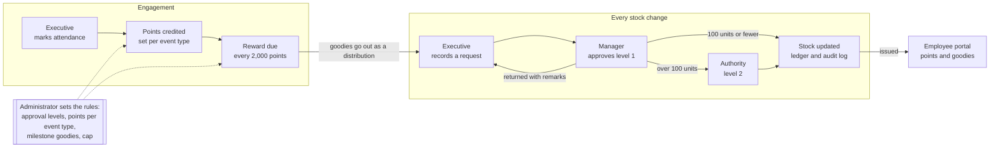

# Mavericks Inventory: demo script and roles guide

A 25-minute walkthrough of every role, in the order the work actually flows: stock comes in, goodies go out with approval, employees earn points at events, and milestones turn into goodies.

**Contents:** [Before you start](#before-you-start) · [The five roles](#the-five-roles) · [How the processes connect](#how-the-processes-connect) · [Part 1, Executive](#part-1-executive-stock-and-a-distribution) · [Part 2, approvals](#part-2-manager-and-management-authority-approvals) · [Part 3, engagement](#part-3-executive-event-attendance-points-and-rewards) · [Part 4, Employee](#part-4-employee-the-portal) · [Part 5, Administrator](#part-5-administrator-rules-users-audit-system-status) · [Ask Mav](#ask-mav-questions-to-try-for-each-role) · [Audience questions](#questions-the-audience-may-ask)

## Before you start

- **Link:** [mavericks-inventory-nu.vercel.app](https://mavericks-inventory-nu.vercel.app). The sign-in page shows **Explore the demo** with one button per role. One click signs you in; no typing.
- **Two browser windows:** open a normal window and a private (incognito) window side by side. Sign in as the maker (Executive) in one and the checker (Manager) in the other, so the audience sees a request leave one person and arrive with the other.
- **Switching roles:** your name at the top right, then **Sign out**, then pick the next role.
- **Password**, if anyone types it: `Mavericks@2026` for every demo account.
- **Timing:** about 25 minutes. Parts 1 and 2 take 8 minutes, Part 3 takes 7, Parts 4 and 5 take 5 each.
- **Data:** names and numbers are sample data. If a request mentioned below was already approved during practice, use any other request in the same list.

## The five roles

The app splits the work so that no one person can both request and approve stock: the maker-checker rule auditors look for.

| Role | Demo person | Does | Can't do | Lands on |
| --- | --- | --- | --- | --- |
| **Executive** (maker) | Kavin Raj | Adds stock items, records distributions, stock inward and stock counts, creates events, marks attendance, hands out points rewards | Approve anything | Home with the to-do list |
| **Manager** (checker, level 1) | Rahul Iyer | Approves or returns requests; sees stock, events, points, reports and the audit log | Create requests; approve their own | Home, then Approvals |
| **Management Authority** (level 2) | Meera Krishnan | Gives the final approval on large requests (over 100 units in the demo) | Approve both levels of the same request | Approvals |
| **Administrator** | Sanjana Rao | Users and roles, approval rules, points per event type, milestone goodies, adjusting or resetting points, master lists, audit log, system status | Create or approve requests | Home |
| **Employee** | Priyanka Sharma | Sees only their own points, progress to 20,000, rewards, goodies received and events | See stock, other people or any staff page | My dashboard |

Three rules hold for everyone: stock changes only at final approval; nobody approves their own request; every points change carries a reason and stays in the history.

## How the processes connect

The top row is every stock change: the executive makes it, a manager (and for large requests the authority) checks it, and only then does stock move. The bottom row is engagement: attendance earns points, milestones create rewards, and rewards go out through the same approval before the employee sees them as received.

## Part 1, Executive: stock and a distribution

Point to make: an executive records everything, but nothing leaves the shelf until a manager says yes.

1. Sign in as **Executive**. Mav waves hello. **Say:** "The top bar is the same for everyone: search, Ask Mav, the bell. The left menu is grouped by the kind of work."
2. On **Home**, point at **Needs your attention** (drafts, low stock, rewards due) and the tiles: **On hand**, **Reserved** (in requests waiting for approval) and **Free to promise** (what can still be given out).
3. **Items** (menu, Inventory). Show the **Low** tab, then the columns **Reserved**, **Free to promise** and **Cover** (days the stock lasts at the last 90 days' pace). **Say:** "This is how large stores teams track stock: not just what's on the shelf, but what's already promised."
4. Open **Bluetooth Speaker**. Note the **Available** number. Show the movement ledger and recipients.
5. **Distributions → Record a distribution.** Title "Speaker giveaway", item *Bluetooth Speaker*, quantity 2, a recipient name and employee ID. Select **Submit for approval**.
6. Go back to the speaker: **Available hasn't changed.** **Say:** "It's reserved, not gone. Stock moves only on approval."
7. Optional: try quantity 100000. The line turns red and Submit is blocked: you can't give away stock you don't have.
8. Optional: **Distributions → Upload Excel** to show that the old Recipient sheet uploads as it is; bad rows come back in an error report.
9. Optional: **Stock counts → New count.** Type a count one lower than the system for an item, choose the reason "Damaged", submit. Only differences go for approval.

## Part 2, Manager and Management Authority: approvals

Point to make: the checker sees everything needed to decide, every decision is recorded, and big requests need two different people.

1. In the private window, sign in as **Manager**. The bell and the **Approvals** badge show requests waiting; overdue ones (older than 48 hours) are flagged red.
2. Open **Approvals**, then the "Speaker giveaway" request. Show the lines, the stock check, and that there's no edit button: the manager can only approve or return.
3. Select **Approve and update stock**, add a remark, confirm. Switch to the Executive window and refresh the speaker: **Available dropped by exactly 2**, and the ledger shows who approved it.
4. **Return with remarks:** open another waiting request (for example "Intern welcome, batch 14"), select **Reject**, write "Please split by location". Sign in as Executive, open **My requests**: the remark is shown; the executive edits and resubmits. The approval history lists every step.
5. **Two levels:** open a large request (for example "New goodies for April onboarding", 970 units). The Manager approves level 1; it then waits for level 2. Sign in as **Management Authority** and give the final approval. **Say:** "Above 100 units the rules need two signatures from two different people. The admin sets that threshold."
6. Optional: tick several requests in **Approvals** and approve them together.
7. **Reports** (menu, Analytics): open **Distributed stock**, select **Excel** or **PDF**. **Say:** "Reports read only approved records, so they always match the ledger."

## Part 3, Executive: event, attendance, points and rewards

Point to make: attending events earns points instantly, every 2,000 points earns a goodie, and the goodie goes out through the same approved process as any other stock.

How points work: each event type is worth a fixed number of points that the admin sets (tech talk 200, webinar 150, tech event 300, workshop 400, codeathon 500, hackathon 600, non-tech event 100, leadership connect 150, CSR activity 250). Milestones are every 2,000 points up to 20,000.

1. Sign in as **Executive**. Open **Events**: tabs for upcoming, completed and cancelled, and the last 90 days' totals at the top.
2. **New event:** name "Cloud workshop: Terraform basics", type **Workshop (400 pts)**, today's date. Select **Create event**.
3. Under **Mark attendance**, paste `2000149999, 2000150001, 9999999990` and select **Mark 3 present**. The result shows: 2 marked (+400 each), 1 ID not found, and anyone who **crossed a milestone**. **Say:** "You can also upload the attendance sheet from Teams or the registration form; new names are added automatically."
4. Paste the same IDs again: they're skipped as **already marked**. No one gets points twice.
5. Open **Employees and points**, then Priyanka Sharma (2000149999): current points, rank, the progress track with a gift at every 2,000, her rewards and points history with the workshop at the top.
6. Open **Rewards** (the menu badge counts rewards due). Tick a few people, including Priyanka, and select **Create distribution and submit**. The milestone's goodie is filled in for each person.
7. As **Manager**, approve that request. Back in **Rewards**, the **Issued** tab now lists them, and the goodies are off the shelf.
8. Optional: on the event page, remove someone with the minus button and a reason. Exactly their 400 points are reversed.
9. **Leaderboard:** podium, last 90 days, by department. **Say:** "Good for recognising people at town halls."

## Part 4, Employee: the portal

Point to make: every employee can see their own progress and goodies, and nothing else.

1. Sign in as **Employee** (Priyanka Sharma). She lands on **My dashboard**, not Home. Mav greets her; if she has just unlocked a reward, the gift box pops open with confetti.
2. Point at **Your points**, **Events attended**, **Goodies received**, **Rewards on the way** and **Your rank**.
3. **Your journey to 20,000:** green gifts are received, gold ones are earned and on the way, the blue ring is the next one, and the flag shows where she is. The line underneath says how many points to the next goodie.
4. **Rewards** cards show each milestone's goodie and status. **Coming up** lists the next events and their points; **Top 10** appears if the admin switched it on.
5. **Goodies received** and **Points history** (left menu): every goodie with its date and reason, and every points change with the balance after.
6. **Security check:** type `/stock` or `/employees` at the end of the address. She is sent straight back to her dashboard. **Say:** "Employees can only ever see their own record."

## Part 5, Administrator: rules, users, audit, system status

Point to make: the business rules are settings the admin controls, not code, and every change is traceable.

1. Sign in as **Administrator**. Open **Points and rewards rules**.
2. **Points per event type:** edit Workshop from 400 to 450 and save. **Say:** "New attendance gets 450; points already given don't change." (Set it back to 400 afterwards.)
3. **Milestone goodies:** edit the 18,000 milestone and choose a goodie, or leave it "to be decided" for executives to pick per person.
4. **Milestones:** "a goodie every 2,000 points, maximum 20,000", and the switch for showing the top 10 to employees. **Start a new programme year** resets everyone to zero (type RESET to confirm); earned rewards are kept. Don't press it in the demo.
5. **Employees and points**, open a person: **Adjust points** (+500, reason "Organised Mavericks Week") and **Reset points**. Both need a reason and appear in their history.
6. **Approval rules:** one or two levels, the 100-unit threshold for level 2, the stock guard and the 48-hour overdue time.
7. **Users and roles:** add a user; they get a one-time password and must change it on first sign-in. With company single sign-on, roles come from Microsoft Entra ID instead.
8. **Audit log:** every sign-in, change and decision with before and after values. Show the points change you just made.
9. **System status:** where the app and database run and how fast they talk. **Say:** "If anyone says it's slow, this page says why and how to fix it."

## Ask Mav: questions to try for each role

Ask Mav (top bar) answers from live data and only within the role signed in. Show the same question from two roles to prove the limit.

| Role | Try asking | What it shows |
| --- | --- | --- |
| Executive | "Which items are running low?" | Items at or below reorder level, with a link to plan stock inward |
| Executive | "How many black t-shirts do we have?" | On hand, reserved and free to promise per size |
| Executive | "How do I record event attendance?" | Step-by-step help for that role |
| Manager | "What's waiting for my approval?" | Requests waiting, their age, overdue flag |
| Manager | "Distributions in the last 30 days" | Units handed out, top items and purposes |
| Administrator | "How many points does 2000149999 have?" | That employee's points, next milestone and rewards |
| Employee | "How many points do I have?" | Her own points and rewards |
| Employee | "How many points does Kavin Raj have?" | Refuses: she can only see her own |
| Anyone | "What's the weather?" | Declines: outside the app |

## Questions the audience may ask

- **What if someone is marked present by mistake?** The executive removes them with a reason; exactly those points are reversed, and an unclaimed reward below the new total is cancelled.
- **What happens at 20,000 points?** Points stop at the cap. The admin can reset the person (or everyone) to start a new cycle; earned rewards stay.
- **Who decides the goodie for each milestone?** The admin, per milestone, and can change it any time. If none is set, the executive picks one per person when handing out.
- **Can a manager approve their own request?** No. And on large requests, level 1 and level 2 must be different people.
- **Can stock go negative?** No. It's checked on submit and again at approval, so two approvals at the same moment can't hand out the same units.
- **Can we delete or edit history?** No. The ledger, points history and approval history can't be changed; corrections are new entries. Every change is in the audit log.
- **Can employees sign in with their Hexaware account?** Yes, with company single sign-on (Microsoft Entra ID), set up in the [deployment guide](SETUP-AND-DEPLOYMENT.md#13-company-single-sign-on-sso). Roles come from Entra; everyone else can default to the employee portal.
- **Can we bring in the old Excel trackers?** Yes. The Stock count, Recipient and Procurement sheets upload as they are.
- **Where does it run in production?** Vercel, AWS or Azure, with a PostgreSQL database. Steps are in the [setup and deployment guide](SETUP-AND-DEPLOYMENT.md).
