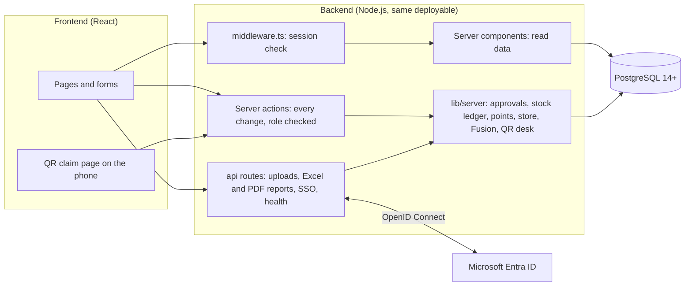

# Mavericks Inventory: production handover

For the team taking the app to production. It covers what the frontend and backend are, how to deploy them in Hexaware's environment, how company sign-in (SSO) works, and what to check on day one. Step-by-step platform instructions are in [SETUP-AND-DEPLOYMENT.md](SETUP-AND-DEPLOYMENT.md).

## 1. Frontend and backend

The app is one Next.js 15 project (React 19 + TypeScript) with a PostgreSQL database. The frontend and the backend live in the same codebase and ship as **one deployable**: a single Node.js server (or one Docker image) serves the pages and runs the server code. There is no separate API server to host, and no business logic runs in the browser.



| Layer | Folder | What's in it |
| --- | --- | --- |
| Frontend: pages | `src/app/(app)/…`, `src/app/login`, `src/app/claim` | One folder per screen (stock, approvals, events, store, employee portal, admin) |
| Frontend: components | `src/components/app`, `src/components/ui` | Forms, tables, dialogs (shadcn/ui on Radix), charts |
| Backend: actions | `src/app/actions/*.ts` | Every create, update, approve or upload. Each one checks the role first |
| Backend: API routes | `src/app/api/*` | Excel uploads and templates, report exports (Excel/PDF), SSO start and callback, notifications, health check |
| Backend: business logic | `src/lib/server/*.ts` | `workflow.ts` (maker-checker, stock posting, ledger), `rewards.ts` (points), `store.ts` (points store), `event-goodies.ts` (pre-event approval, vouchers), `claims.ts` (QR desk), `fusion.ts` (weekly HR upload), `sso.ts` |
| Database | `prisma/schema.prisma`, `prisma/migrations` | Tables and versioned migrations (Prisma ORM) |
| Tests | `tests`, `scripts/e2e.mjs`, `scripts/sso-check.mjs` | 30 unit tests, 95 browser checks, 16 SSO checks |

If your production standard needs a separate frontend and backend, the boundary is already clean: everything under `src/lib/server` and `src/app/actions` is backend code with no UI, and could sit behind REST endpoints later. For this app's size, one deployable is simpler and safer to run.

## 2. Deploying in Hexaware's environment

Recommended setup (any of these works; full steps in the setup guide, section 6):

| Piece | Recommended | Notes |
| --- | --- | --- |
| App | Docker container (the repo's `Dockerfile`) on Azure App Service for Containers, Azure Container Apps, or a Hexaware VM with Docker | Node 22. Listens on port 3000. Two instances behind the load balancer for availability |
| Database | Azure Database for PostgreSQL (Flexible Server), same region as the app | Automated backups with point-in-time restore of 7+ days |
| Secrets | Azure Key Vault (or the platform's secret store) | `DATABASE_URL`, `DIRECT_URL`, `AUTH_SECRET`, `SSO_CLIENT_SECRET` |
| Sign-in | Microsoft Entra ID app registration | See section 3 |
| Address | `https://mavericks-inventory.<hexaware-domain>` with a TLS certificate | Set `APP_URL` to it |

**Production settings** (the full list is in the setup guide, section 3):

```bash
DATABASE_URL="postgresql://…?sslmode=require"
DIRECT_URL="postgresql://…?sslmode=require"
AUTH_SECRET="<48 random characters: openssl rand -base64 48>"
DEMO_MODE="false"                 # no demo accounts or one-click buttons
APP_URL="https://mavericks-inventory.<hexaware-domain>"
SSO_ISSUER="https://login.microsoftonline.com/<tenant-id>/v2.0"
SSO_CLIENT_ID="<application id>"
SSO_CLIENT_SECRET="<from Key Vault>"
SSO_PROVIDER_NAME="Microsoft"
SSO_ALLOWED_EMAIL_DOMAINS="hexaware.com"
SSO_DEFAULT_ROLE="EMPLOYEE"       # everyone without an app role gets their own portal
SSO_ONLY="true"                   # after go-live: hide the password form
```

**First deployment:**

1. Create the database, then run `npx prisma migrate deploy` (creates every table). Don't load demo data.
2. Start the container with `BOOTSTRAP_ADMIN_EMAIL` and `BOOTSTRAP_ADMIN_PASSWORD` set; sign in with them once to create the first administrator, then remove both settings.
3. The administrator sets approval rules, low-stock threshold (50), points per event type and the points-store goodies.
4. Load opening stock with the stock Excel upload, and upload the first **Fusion report** (Employees and points → Upload Fusion report).
5. Switch on SSO (section 3), check it, then set `SSO_ONLY=true`.

**Updates:** build the new image, run `npx prisma migrate deploy`, then roll the containers. Migrations only add things, so the old version keeps working during the roll.

## 3. How SSO is implemented

Company sign-in uses **OpenID Connect** with Microsoft Entra ID, the standard behind "Sign in with Microsoft". The code is in `src/lib/server/sso.ts`, `src/app/api/auth/sso/start/route.ts` and `src/app/api/auth/sso/callback/route.ts`, written against the standard so any OpenID Connect provider works.

```mermaid
sequenceDiagram
  participant U as Employee (browser)
  participant A as Mavericks Inventory
  participant E as Microsoft Entra ID
  U->>A: Sign in with Microsoft
  A->>U: Redirect to Entra with state, nonce and a PKCE challenge
  U->>E: Company password + MFA
  E->>U: Redirect back with a one-time code
  U->>A: /api/auth/sso/callback?code=…&state=…
  A->>E: Exchange the code (client secret + PKCE verifier)
  E->>A: Signed ID token: name, email, app roles
  A->>A: Verify signature, issuer, audience, expiry and nonce; find or create the user; apply the role; audit
  A->>U: Session cookie (HttpOnly, Secure), app opens
```

- **Flow:** authorization code with PKCE, `state` (stops forged callbacks) and `nonce` (stops replayed tokens). The ID token is verified against Entra's published signing keys. The client secret never leaves the server.
- **Roles come from Entra app roles.** IT creates five app roles on the app registration and assigns people or AD groups to them: `Inventory.Executive`, `Inventory.Manager`, `Inventory.Authority`, `Inventory.Admin`, `Inventory.Employee`. The app maps them to its roles at every sign-in, so a role change in Entra applies at the next sign-in. Anyone without a role gets the employee portal (`SSO_DEFAULT_ROLE=EMPLOYEE`) or is refused.
- **Accounts:** created automatically on first sign-in and matched by email to any existing account. Employees are linked to their record from the Fusion report by email or employee ID.
- **Leavers:** disabled in Entra means they can't sign in. The weekly Fusion upload also marks them inactive in the app, so they stop earning points and can't order or collect goodies.
- **Session:** a signed JWT in an HttpOnly, Secure, SameSite=Lax cookie (`mi_session`), checked by `middleware.ts` on every request. Every action checks the role again on the server.
- **Break-glass:** one local administrator account can still sign in at `/login?local=1` if Entra is down.

**What IT needs to do in Entra (about 15 minutes):** register an app, add the redirect URI `https://<app address>/api/auth/sso/callback`, create a client secret, add the five app roles, assign groups, and send the tenant ID, client ID and secret to whoever sets the app's settings. Setup guide section 13.3 has every click.

**Test without Azure:** `node scripts/mock-oidc.mjs` runs a fake identity provider, and `npm run sso-check` runs 16 sign-in checks against it (they also run in GitHub on every push).

## 4. Weekly Fusion report

- Once a week, an executive uploads the Fusion Connect report on **Employees and points**. It's read in the browser; only employee ID, name, DHR status, last working date, designation, grade, base location and BU are sent to the server. The full file (about 10 MB) is never stored.
- New joiners are added, and everyone is marked active or resigned from the DHR Status column. Only active employees can earn points, order from the store, win prizes or collect goodies at the QR desk.
- From day 5 after the last upload, the bell and Home remind executives and administrators; after day 7 it shows as overdue.
- **Never commit the Fusion report to the code repository.** It holds personal data for every employee.

## 5. Day-one checklist

- [ ] `DEMO_MODE=false`, no demo data loaded, demo accounts absent
- [ ] `AUTH_SECRET` is new and only in the secret store; the repository has no `.env` or data files
- [ ] SSO signs in an executive, a manager and an employee with the right screens; `SSO_ONLY=true` once checked
- [ ] Database backups on and one restore tested
- [ ] First Fusion report uploaded; reminder date shown on Employees and points
- [ ] Points-store goodies and prices set by the administrator; low-stock threshold 50
- [ ] `/api/health` monitored (returns 503 if the database is unreachable)
- [ ] The full browser check (`npm run e2e`) passes against the UAT address with demo data, before production data goes in
