# Mavericks Inventory: user guide

Mavericks Inventory keeps track of the goodies, welcome kits, T-shirts, bottles and gadgets the Mavericks team hands out, and rewards employees for taking part in events. It replaces the old Excel trackers.

- **Stores:** you record what came in and who received what, and a manager approves it before the stock count changes, so the numbers always match the shelf.
- **Engagement:** every tech talk, workshop, hackathon or celebration someone attends earns them points. Every 2,000 points earns a goodie, up to 20,000. Employees can sign in to see their own points, progress and goodies.

This guide walks through every screen and button. You don't need any technical knowledge. The pictures come from the demo version, so the names and numbers are examples.

**Contents**

- [How it works in one picture](#how-it-works-in-one-picture)
- [Who can do what](#who-can-do-what)
- [Signing in](#signing-in) and [trying the demo](#trying-the-demo)
- [Finding your way around](#finding-your-way-around)
- [Ask Mav, the assistant](#ask-mav-the-assistant)
- [For Executives](#for-executives): [look up items](#look-up-items) · [record a distribution](#record-a-distribution) · [upload a distribution sheet](#upload-a-distribution-sheet) · [add new items](#add-new-stock-items) · [upload a stock sheet](#upload-a-stock-sheet) · [record stock inward](#record-stock-inward) · [count stock](#count-stock) · [stock movements](#stock-movements) · [drafts and returned requests](#drafts-and-returned-requests)
- [Events, points and rewards](#events-points-and-rewards): [how points work](#how-points-work) · [create an event](#create-an-event) · [upload events from Excel](#upload-events-from-excel) · [mark attendance](#mark-attendance) · [winners and prizes](#winners-and-prizes) · [hand out rewards](#hand-out-rewards) · [employees and points](#employees-and-points) · [leaderboard](#leaderboard)
- [For Managers and the Management Authority](#for-managers-and-the-management-authority): [the approval queue](#the-approval-queue) · [approve](#approve-a-request) · [return with remarks](#return-a-request) · [two-level approval](#two-level-approval) · [approve several at once](#approve-several-at-once)
- [Reports](#reports)
- [For System Administrators](#for-system-administrators): [users](#add-and-manage-users) · [approval rules](#approval-rules) · [points and rewards rules](#points-and-rewards-rules) · [adjust or reset points](#adjust-or-reset-points) · [master data](#master-data) · [audit log](#audit-log) · [system status](#system-status)
- [For Employees: your portal](#for-employees-your-portal)
- [Your profile and password](#your-profile-and-password)
- [Questions people ask](#questions-people-ask)

---

## How it works in one picture

Every change to stock goes through a **request**. A request moves through these stages:

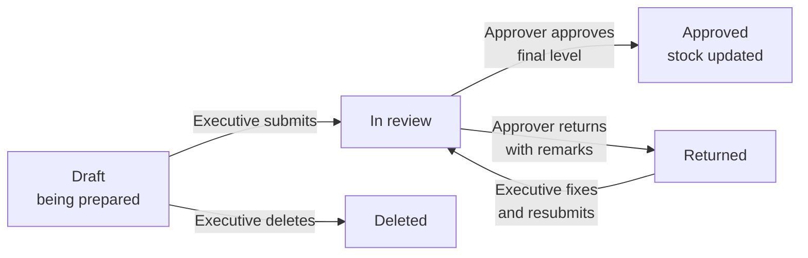

There are four kinds of request:

| Request | Used for | What approval does to stock |
| --- | --- | --- |
| **Distribution** | Goodies handed to people (onboarding, events, interns, points rewards…) | Takes the quantities **off** the shelf |
| **Stock inward** | A delivery of more of something you already stock | **Adds** the quantities |
| **New stock items** | Products you've never stocked before | Creates the items with their opening quantity |
| **Stock count** | A physical count that found a difference | Corrects the quantity by the difference found |

**Nothing changes in stock until the final approval.** A draft or a request in review doesn't touch the numbers.

Points work alongside this:

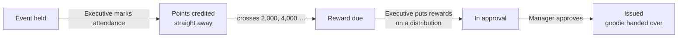

---

## Who can do what

| Role | What they do |
| --- | --- |
| **Executive** | Adds stock items, records distributions, stock inward and stock counts (one at a time or by uploading Excel), creates events, marks attendance, hands out points rewards, and fixes anything an approver returns |
| **Manager** | Approves or returns requests (level 1). Sees stock, events, employees' points, reports and the audit log |
| **Management Authority** | Approves or returns requests at level 1 or level 2 (the final say when two levels are switched on) |
| **System Administrator** | Adds users and sets roles, sets the approval rules and the points and rewards rules, adjusts or resets points, manages the lists people pick from, views the audit log and system status |
| **Employee** | Sees only their own portal: points, progress to 20,000, rewards, goodies received and events |

Three safety rules apply to everyone:

- **Nobody approves their own request.** The person who created it never sees an Approve button on it.
- **When two levels are needed, they're signed by two different people.**
- **Every points change has a reason** (an event, or a written reason for an adjustment or reset) and stays in the person's points history.

---

## Signing in

1. Open the address your administrator gave you.
2. Enter your **work email** and **password**, then select **Sign in**.

If your company has switched on single sign-on, the page shows **Sign in with Microsoft**. Select it and sign in with your normal Hexaware account; you don't need a separate password. If it says you don't have access yet, ask the administrator to give you a role.

- New users get a **one-time password** from the administrator. The first time you sign in you'll be asked to choose your own (see [Your profile and password](#your-profile-and-password)).
- After 5 wrong passwords the account waits 5 minutes before you can try again.
- Forgot your password? Ask a System Administrator to reset it; you'll get a new one-time password.

### Trying the demo

On the demo site, the sign-in page lists the demo people under **Explore the demo**. Select a role and you're signed in straight away, no typing needed:

| Select | You sign in as | Good for seeing |
| --- | --- | --- |
| **Executive** | Kavin Raj | Stock, distributions, events, attendance, rewards |
| **Manager** | Rahul Iyer | The approval queue |
| **Management Authority** | Meera Krishnan | Level-2 approvals |
| **Administrator** | Sanjana Rao | Users, approval rules, points and rewards rules, audit log, system status |
| **Employee** | Priyanka Sharma | The employee portal: points, progress, goodies |

All demo accounts use the password `Mavericks@2026` if you prefer to type it (open **Sign in with email and password**). Demo accounts are shared, so their passwords can't be changed.

---

## Finding your way around

The screen has three parts, like most large business systems:

- **The dark bar at the top** is always there: the menu button, the search box, **Ask Mav** (the assistant), the **bell** (things that need your attention), the light/dark switch and your name.
- **The menu on the left** is grouped by kind of work: **Inventory** (items, stock movements, stock inward, stock counts), **Fulfilment** (distributions, requests, approvals), **Engagement** (events, employees and points, milestone rewards, event prizes, leaderboard), **Analytics** (reports) and **Administration**. What you see depends on your role. The menu button at the top left folds it to icons.
- **The page** in the middle.

**Home** is the first page after sign-in:

- **A hello from Mav** with today's date, how many things need you, and the one or two actions your role uses most. Select the cross to hide it for the day.
- **The number tiles:** On hand, Reserved (in distributions waiting for approval), Free to promise (on hand minus reserved), Handed out in the last 30 days (with a 12-week trend line), Low or out, and Event points in the last four weeks. Select a tile to open the matching list.
- **Needs your attention:** your to-do list, most urgent first: overdue approvals, requests waiting for you, requests sent back to you, unfinished drafts, items out of stock or running low, rewards due and past events without attendance.
- **Engagement:** the next events and this quarter's five most active people.
- **Units handed out per week**, **Where stock went**, **Needs restocking**, **Recent decisions** and **Size runs** (every T-shirt and welcome-kit size side by side; a yellow outline means low, red means gone).

**Search (top bar).** Select the search box or press **Ctrl + K** and type part of an item name, a stock code, a request number, an employee's name or ID, an event, or the name of a page. Select a result to open it.

**The bell** shows a red number when something needs you. Select it for the list; select an entry to go there.

**Light or dark.** The moon/sun button at the top right switches the colour scheme.

**On a phone,** the menu opens from the button at the top left, and tables show the most important columns.

**Account menu** (your name, top right): **Profile and password** and **Sign out**.

When you select a link, a thin blue line runs across the very top of the window until the next page appears.

---

## Ask Mav, the assistant

Select **Ask Mav** in the top bar. A panel opens on the right. Type a question in plain words, or select one of the suggestions.

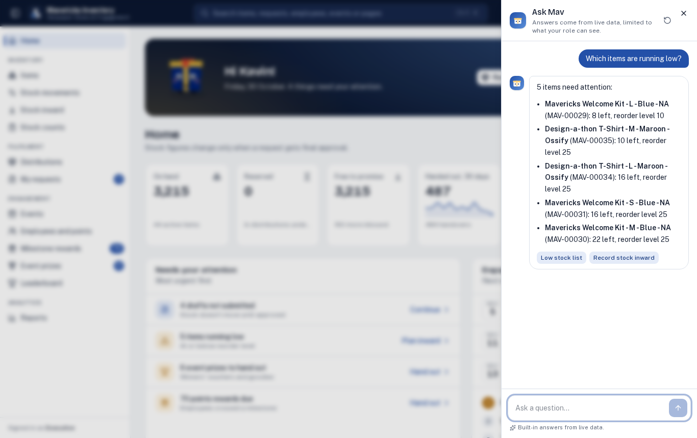

Examples:

- "How many black t-shirts do we have?" (on hand, reserved and free to promise)
- "Which items are running low?"
- "What's waiting for my approval?"
- "Distributions in the last 30 days"
- "Rewards due", "Show the leaderboard", "Upcoming events"
- "How many points does 2000150001 have?"
- "How do I record event attendance?" (step-by-step help)

**Mav only answers from what your role is allowed to see.** An employee asking about someone else's points gets their own instead; a manager can't see the step-by-step help for executive-only tasks. It doesn't answer questions about anything outside Mavericks Inventory. The links under each answer open the page the answer came from. Answers come from live data, so they're always current.

---

## For Executives

### Look up items

Select **Items** in the menu (under Inventory).

- Each row shows the item, its category, its variant (size, colour, brand) and **On the shelf**: available now / everything ever stocked. The bar fills with what's left: blue is fine, yellow is low, red is out.
- **Reserved** is stock in distributions waiting for approval. **Free to promise** is on the shelf minus reserved: what you can still give out. **Cover** is how many days the stock lasts at the pace of the last 90 days (red under 14 days, yellow under 45).
- Use the tabs to show **All active**, **Low**, **Out** or **Awaiting approval** (new items not yet approved).
- **All categories** filters by category. The search box finds items by name, code or brand.
- **Export** downloads the list as Excel. **Upload Excel** and **Add item** are explained below.

Select an item to see its full story:

- **Stocked so far / Handed out / In review / Available.** "In review" is stock in distributions waiting for approval; it hasn't been deducted yet.
- **Movement ledger:** every approved movement with the running balance. **Excel** downloads it.
- **Recipients:** who received this item, when and why.
- **Stock inward** and **Distribute** start a request with this item already chosen.

### Record a distribution

Use this when you hand goodies to people. Select **Distributions → Record a distribution** (or **Distribute** on an item).

1. **Request title:** something you'll recognise later, for example "Onboarding batch 21 welcome kits".
2. **Purpose, Distribution date, Location, Handed over by (POC):** these apply to every line.
3. **Remarks for the approver:** optional context.
4. Under **Items and recipients**, for each person: choose the **Item** (type to search; the number shows how many are available), the **Qty**, their **Emp ID** and **Recipient name**. Select **Add line** for the next person. The bin icon removes a line.
5. Select **Submit for approval**, or **Save draft** to finish later.

After submitting, the request shows **In review**. You can't change it while it's being reviewed; if the approver returns it, you can.

**Not enough stock?** If the lines add up to more than is available, the item turns red and the request can't be submitted until you reduce the quantities.

### Upload a distribution sheet

For events with many people, upload Excel instead of typing. Select **Distributions → Upload Excel**.

1. **Download template**, fill one row per handover, and save it. Your **old "Recipient" sheet works as it is**: Date of Delivery, Emp ID, Name, Base Location, Category, POC and Product Details are recognised, one unit per row.
2. **Choose a file** (or drag it onto the box).
3. Optionally give a **Request title** and **Default purpose**, then select **Validate and save as draft**.

The result shows how many rows were saved and lists each problem row with the reason, for example an item name that doesn't match any stock. **Error report** downloads those problems as Excel so you can fix and re-upload just those rows. **Review draft** opens the new draft; check it and submit it from there.

Items are matched by **Stock Code**, or by the exact **Product Details** text shown on the stock page.

### Add new stock items

For a product you've never stocked. Select **Stock → Add item**.

1. Fill **Product**, **Category**, and **Size / Colour / Brand** if they apply.
2. **Stock name** fills itself in the old tracker style ("Product - Size - Colour - Brand"). You can change it.
3. Leave **Stock code** blank to get the next code automatically (MAV-00045…).
4. Enter the **Opening quantity** (what's on the shelf now) and a **Reorder level**: the item shows as low stock at or below this number.
5. Select **Add to draft**.

Items you add go into one draft, so you can add several and submit them together:

Select **Submit for approval**. The opening quantities go into stock once it's approved.

### Upload a stock sheet

To add many new items at once, select **Stock → Upload Excel**. It works like the distribution upload. Your old **"Stock count"** sheet is recognised (Product Details, Product, Size, Color, Brand and Available).

Rows with problems, such as a stock code that already exists or a quantity that isn't a number, are listed and left out. The good rows become a draft.

### Record stock inward

When a delivery arrives for items you already stock, select **Stock inward → Record stock inward** (or **Stock inward** on an item page).

Give a title, the **PO, invoice or vendor reference** and the **Received on** date, then the item and quantity for each line. Select **Submit for approval**. The quantities are added after approval. The old **"Procurement"** sheet also uploads here (**Upload Excel**).

### Count stock

Count the shelf every few weeks, a category at a time. Select **Stock counts → New count**.

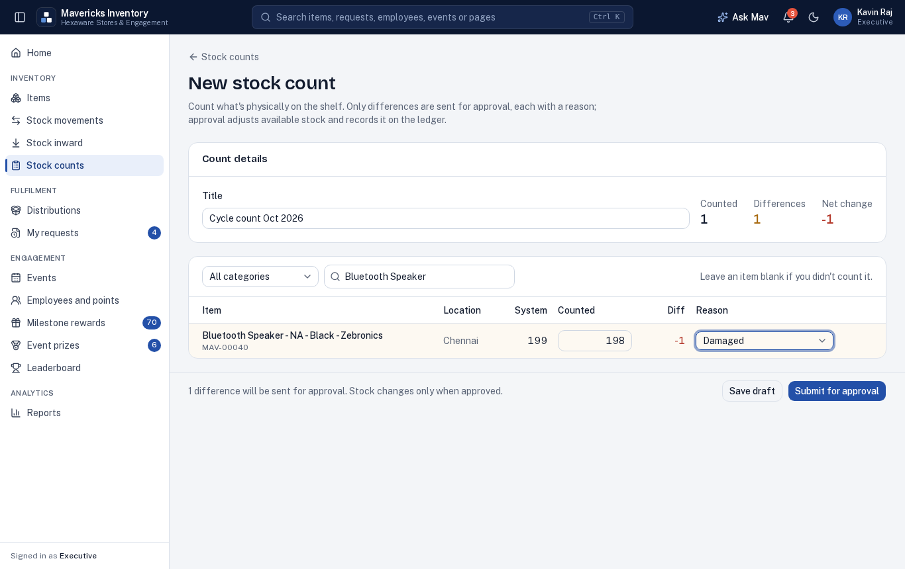

1. Pick a category or search for an item. **System** is what the app thinks is on the shelf.
2. Type what you **counted**. Leave an item blank if you didn't count it.
3. Where the count differs, the **Diff** column turns green (more) or red (fewer). Choose a **reason** for each difference (miscount earlier, damaged, found extra, lost or missing…).
4. Select **Submit for approval**. Only the items that differ go on the request.

When it's approved, available stock moves by the difference you found, and the change shows in **Stock movements** as a count adjustment. If stock moved between your count and the approval, that movement isn't lost: only the difference is applied.

### Stock movements

**Stock movements** (under Inventory) is the ledger: every unit in and out, newest first, with the request it came from, who approved it and the balance after. Use the tabs for inward, distribution, adjustments or opening stock, pick dates, or search for an item. **Export** downloads it as Excel. Ledger lines are never edited or deleted.

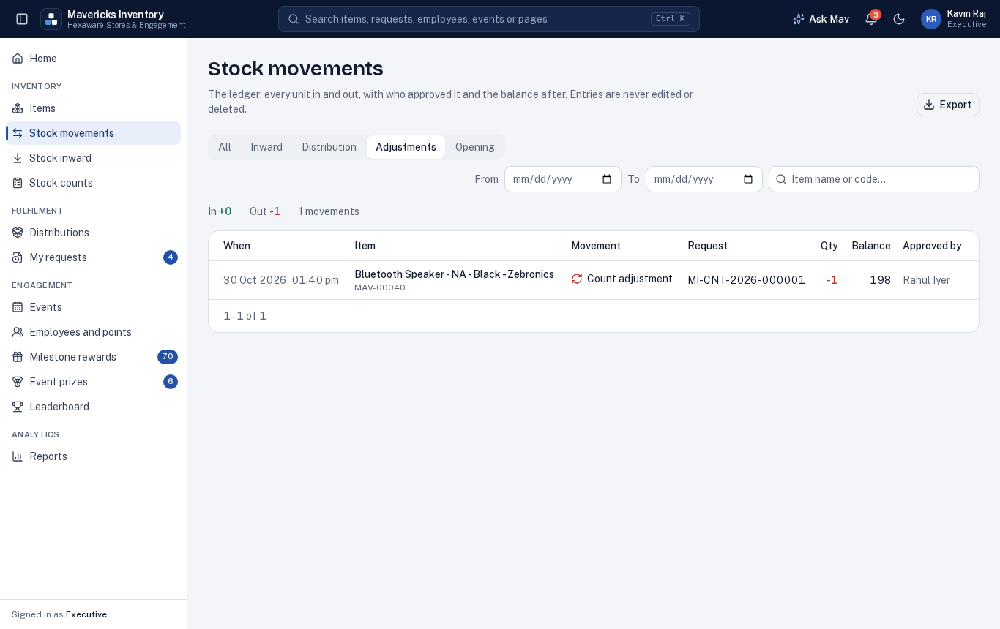

### Drafts and returned requests

**My requests** lists everything you've created. The number next to it in the menu counts drafts and returned requests waiting for you.

Use the tabs (**Drafts**, **In review**, **Approved**, **Returned**) or the search box. **Mine / Everyone's** switches between your requests and the whole team's.

**If an approver returns a request,** it shows **Rejected** with their remarks at the top:

1. Read the remarks.
2. Fix the request: **Edit details** changes the title, purpose or remarks; the ✎ pencil on a line edits it; the bin removes it; **Add line** adds one.
3. Select **Resubmit for approval**.

To throw away a draft, open it and select **Delete draft**. It's kept in the history as "Deleted", but it can't be submitted.

**Excel** on any request downloads its lines.

---

## Events, points and rewards

### How points work

- Each **kind of event** is worth a set number of points. The administrator sets them, for example: tech talk 200, webinar 150, tech event 300, workshop 400, codeathon 500, hackathon 600, non-tech event 100, leadership connect 150, CSR activity 250.
- When an executive marks someone **present** at an event, that event's points are added to the person straight away.
- Every **2,000 points** is a milestone that earns a **goodie**: 2,000, 4,000, 6,000 … up to **20,000**, the maximum. Points above 20,000 aren't added. The administrator can change the step and the maximum.
- The administrator chooses the goodie for each milestone (for example a coffee mug at 2,000, a bottle at 4,000, a backpack at 6,000) and can change it later, or leave it "to be decided" and pick one per person when handing out.
- Crossing a milestone creates a **reward due**. The goodie leaves the shelf only when it's handed out through a normal distribution and approved. The reward then shows as **Issued**, and the employee sees it as **Received**.
- The administrator can **adjust** someone's points (with a reason) or **reset** them to zero to start a new cycle. After a reset, the person can earn every milestone again. Rewards already earned are kept.

### Create an event

Select **Events → New event**.

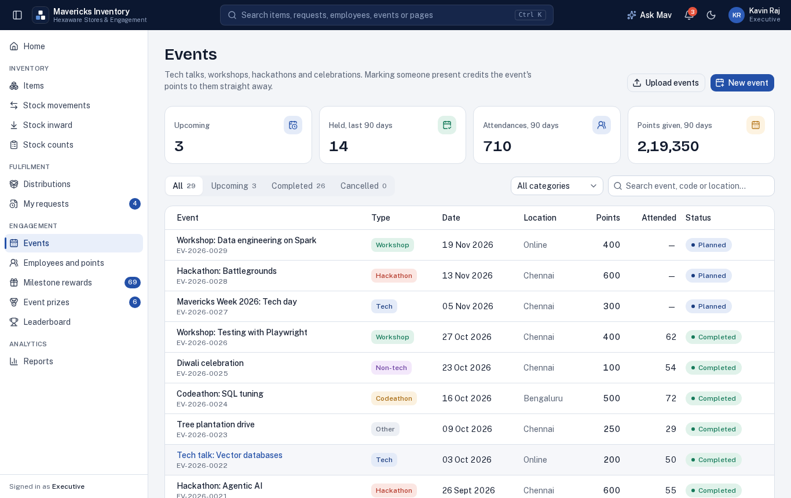

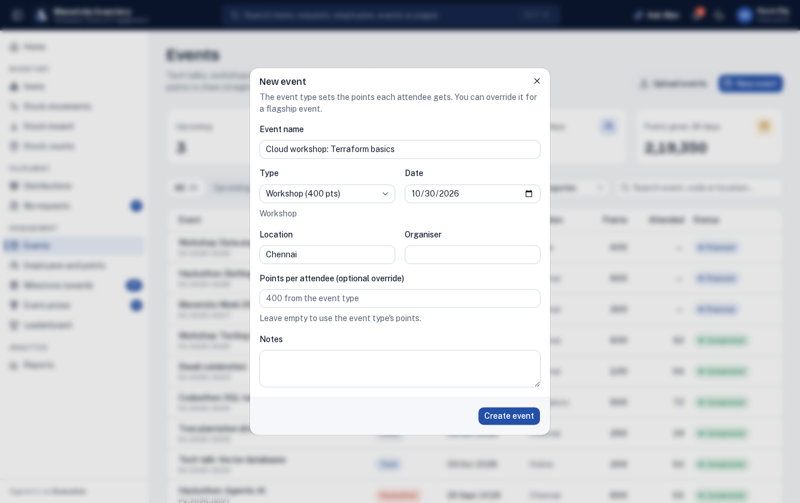

1. Give the event a **name**, choose its **type** (this sets the points), the **date**, location and organiser.
2. For a flagship event you can enter different **points per attendee**; leave it empty to use the type's points.
3. Select **Create event**. Its page opens.

The events list shows tabs for **Upcoming**, **Completed** and **Cancelled**, and the numbers for the last 90 days at the top. You can't change an event's points once attendance is recorded; remove the attendees first, or adjust points per person.

### Upload events from Excel

To plan a quarter at once, select **Events → Upload events**, then **Template** for an example sheet. Fill one row per event:

| Column | Required | Example |
| --- | --- | --- |
| Event name | Yes | Tech talk: Observability with OpenTelemetry |
| Event type | Yes | Tech talk (or one of the other types; "hackathon", "workshop", "tech" and "non-tech" also work) |
| Date | Yes | 12-11-2026 |
| Location | No | Chennai |
| Organiser | No | Kavin Raj |
| Points | No | Leave empty to use the type's points, or enter a number to override |
| Description | No | Any notes |

Select **Choose the Excel file**. The result says how many events were created and how many are upcoming. Rows it couldn't use are listed with the reason (for example an event type that doesn't exist). An event already in the list with the same name and date is skipped, so uploading the same sheet twice is safe. Future events appear under the **Upcoming** tab, on Home and in employees' portals.

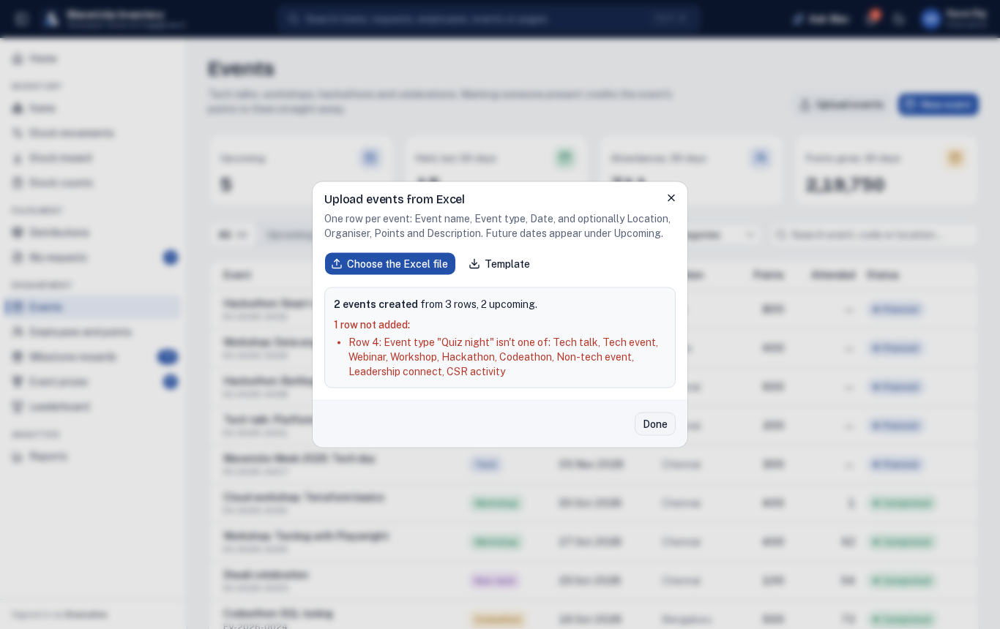

### Mark attendance

On the event's page, under **Mark attendance**:

- **Paste employee IDs** separated by commas, spaces or new lines (straight from Excel or Teams) and select **Mark … present**, or
- select **Upload attendance sheet** and pick an Excel file with an **Employee ID** column (and optionally name, email, department and location). **Template** downloads an example. People in the sheet who aren't in the system yet are added automatically when their name is included.

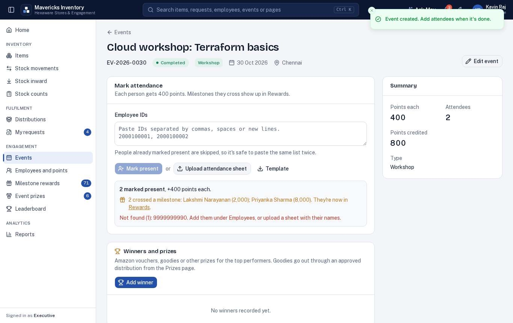

The result tells you how many were marked present and the points each got, who was already marked (they're skipped, so pasting the same list twice is harmless), IDs that weren't found, and who crossed a milestone.

Marked someone by mistake? Select the **minus** button on their row, give a reason, and select **Remove and reverse points**. Exactly the points they got for that event are taken back.

### Winners and prizes

At hackathons, codeathons and contests, record the winners and what they get. Open the event, then **Winners and prizes → Add winner**:

1. Enter the winner's **employee ID** and choose the **position**: Winner, Runner-up, Second runner-up, Top performer or Special mention (the administrator can add more).
2. Choose the **prize**:
    - **Voucher (Amazon or other):** enter the amount in rupees.
    - **Goodie from stock:** choose the item and quantity.
    - **Other:** a trophy, certificate or anything else; describe it.
3. **Bonus points** are filled in from the position (for example 500 for a winner); change them or set 0.
4. Select **Save winner**. If the person wasn't marked present, they are marked present now and get the event's points too.

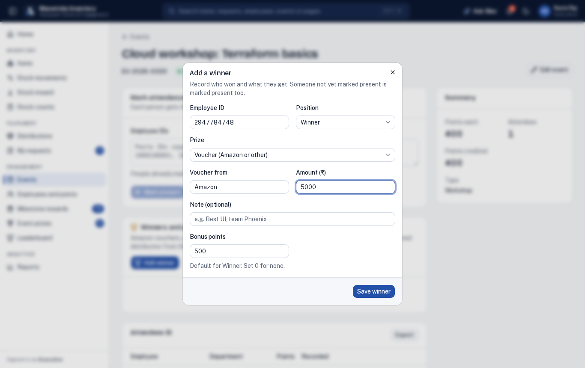

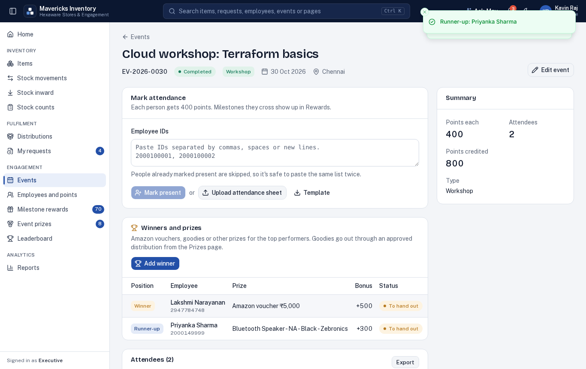

To cancel a prize that hasn't been handed over, select the cross on its row and give a reason; its bonus points are taken back.

**Handing prizes over: Event prizes** (menu, Engagement; the number shows prizes still to hand out):

- **Goodies to hand out:** tick the people and select **Create distribution and submit**. When the manager approves it, the goodies leave the shelf and the prizes show as issued.
- **Vouchers and other:** when you've sent the vouchers, tick them and select **Mark issued**, then type the **order or reference number** (for example the Amazon order number). Never type the voucher code itself. The reference, your name and the time are kept.
- **Export for finance** downloads every prize with the employee, event, voucher amount, status and reference.

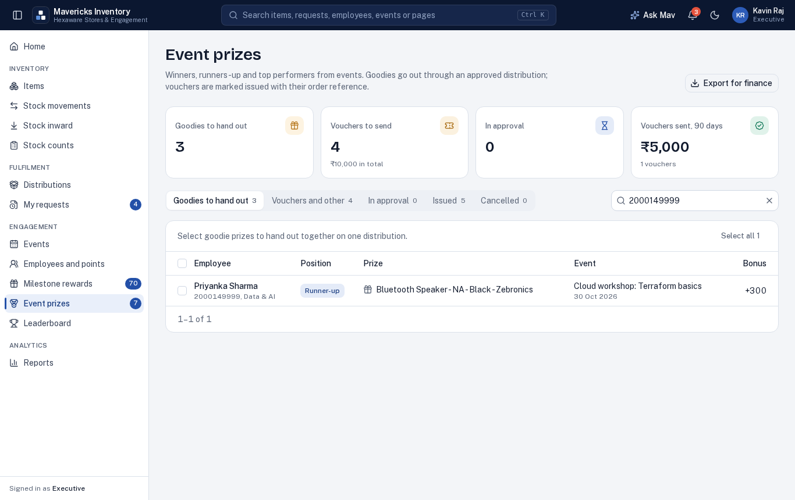

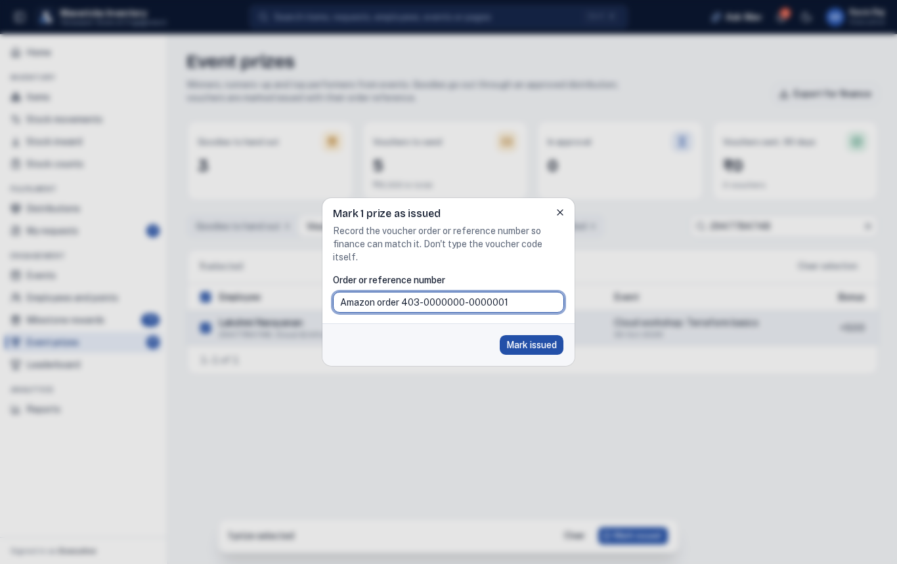

Employees see their prizes in their portal under **Your prizes**, as "On the way" and then "Received".

### Hand out rewards

Select **Milestone rewards** (the number in the menu is how many are due).

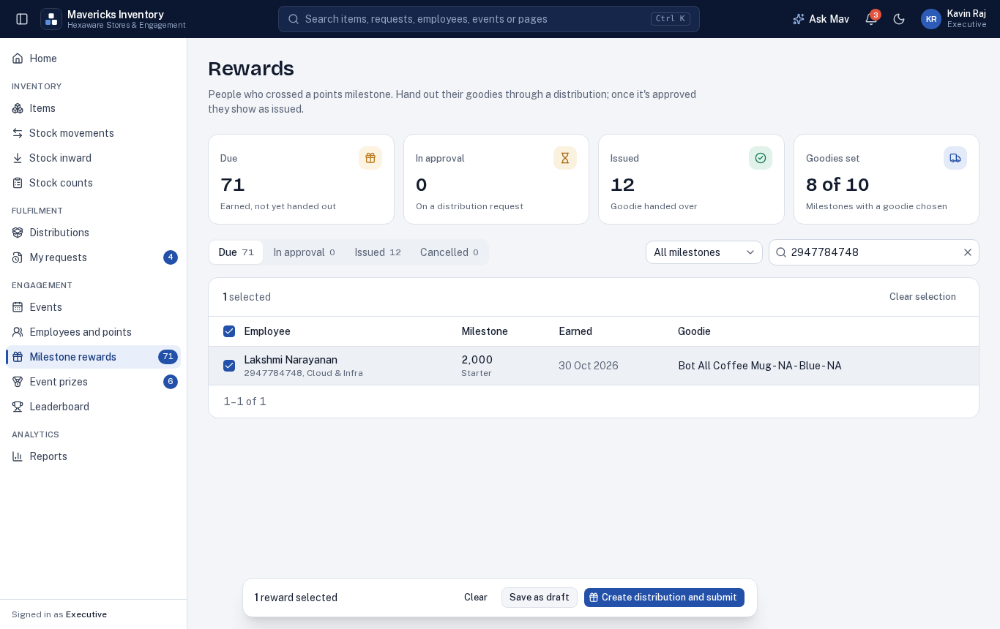

1. The **Due** tab lists everyone who crossed a milestone, oldest first, with the milestone's goodie.
2. Tick the people you're handing goodies to (or **Select all**). If a milestone has no goodie set, choose one on the row.
3. In the bar at the bottom, select **Create distribution and submit** (or **Save as draft**). One distribution request is created with a line per person. If stock is short, the bar warns you.
4. When it's approved, the rewards move to **Issued** and the stock goes down. The **In approval** tab shows rewards on a request that's still waiting.

### Employees and points

**Employees and points** lists everyone with their points, a bar towards 20,000, events attended and rewards due. Tabs show **Active**, **With points**, **Reward due** and **Inactive**; you can sort by name, filter by department and search. **Export** downloads the list.

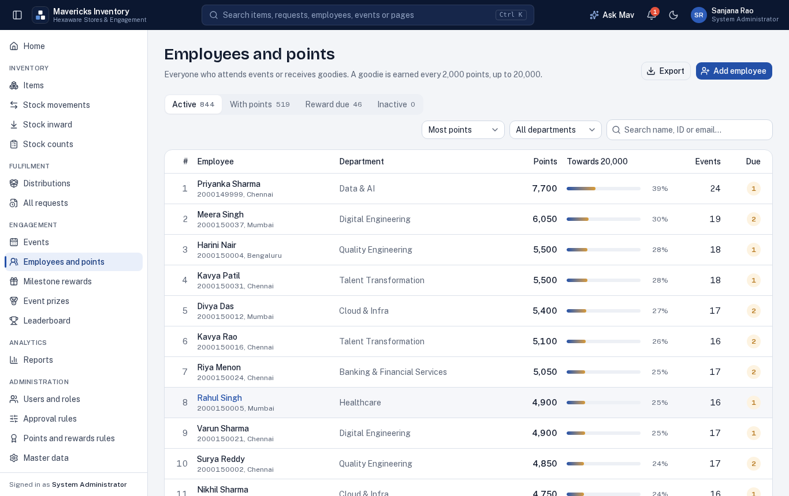

Select a person to see their **current points**, **lifetime points** and **rank**, the **progress track** with a gift at each milestone (green: received, gold: earned), their **rewards**, **points history**, **events attended** and **goodies received**. **Add employee** and **Edit details** keep the list tidy; switching someone to inactive stops them earning points.

### Leaderboard

**Leaderboard** shows the top 50 with a podium for the top three. Switch between **Current points**, **Last 90 days** (event points only) and **Lifetime**, or filter by department. The right side compares departments. Use it to recognise people at town halls and in Mavericks Week.

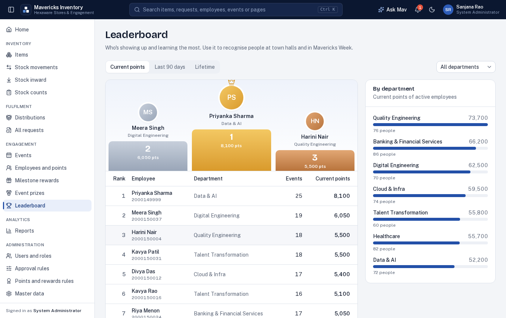

---

## For Managers and the Management Authority

### The approval queue

Select **Approvals**. The number in the menu is how many requests are waiting for you.

- Oldest first. **Waiting** turns yellow after the time set by the administrator (48 hours by default).
- **Check** tells you at a glance whether there's enough stock (green) or how many items are short (red).
- You only see requests at a level your role can approve, and never your own.
- **Your recent decisions** lists what you've approved or returned.

### Approve a request

Open a request from the queue. Check the **Stock impact** box, which shows what approval will take off the shelf (`available now → after`), then the lines.

1. Select **Approve and update stock** (final level) or **Approve level 1** (when a second level follows).
2. Add remarks if you like, then select **Approve**.

At the final level the stock changes immediately and the request shows **Approved**:

If, between submission and approval, someone else's approval used up the stock, the app stops and tells you which item is short; nothing is half-applied.

### Return a request

Select **Reject**, write **what needs to change** (required), and select **Reject request**. The request goes back to the executive with your remarks; stock doesn't change.

Every request keeps its full **Approval history**: who created, submitted, returned, resubmitted and approved it, when, and the remarks.

Points rewards and stock counts come through the same queue. A rewards distribution has one line per person, with the milestone in the remarks; a stock count shows the system figure, the count, the difference and the reason.

### Two-level approval

When the administrator switches on two levels (optionally only for requests above a number of units), the request shows **In review, level 1 of 2**:

1. A **Manager** (or the Management Authority) approves level 1.
2. A **Management Authority** gives the final approval. It must be a different person from level 1.

### Approve several at once

In the queue, tick the requests (or the box in the header for all that can be approved) and select **Approve N selected**. Each is checked separately; if one can't be approved (for example not enough stock), the others still go through and you're told which one failed.

---

## Reports

Select **Reports**. Every report reads from approved records only, so it matches the ledger. **Excel** at the top right downloads every matching row with your current filters (the screen shows the first 100). **PDF** gives a printable version of up to 5,000 rows.

| Report | Shows | Filters |
| --- | --- | --- |
| **Current stock availability** | Opening, received, distributed and available for every item | Category, low/out of stock, search |
| **Distributed stock** | Every approved handover: date, item, quantity, recipient, location, purpose, POC | Dates, purpose, location, item, recipient name or Emp ID |
| **Pending approval** | Requests waiting, their level and how long they've waited | — |
| **Approval history** | Every submission, approval and return, with remarks | Dates, request number or title |
| **Stock movement ledger** | Every movement in and out with the running balance | Dates, item |
| **Employee points** | Every employee's current and lifetime points, cycle, events attended and rewards | Employee name or ID |
| **Event attendance** | Who attended which event and the points they got | Dates, employee |
| **Points rewards** | Milestone rewards with their status, the goodie and the request that carried it | Status, dates, employee |
| **Event prizes** | Winners and top performers, their prize, voucher amount, status and reference: the list finance needs | Status, event dates, employee or event |

---

## For System Administrators

### Add and manage users

Select **Users & roles**.

**Add a person:** select **Add user**, fill **Employee ID**, **Full name**, **Work email**, **Role** (the description underneath says what that role can do), and optionally department and location. Select **Create user**.

You'll see a **one-time password**. Use the copy button, share it with the person privately, and select **Done**. It isn't shown again.

On each row:

- ✎ **Edit:** change details or role, or switch **Account active** off. A deactivated person can't sign in, but everything they did stays in the records.
- 🔑 **Reset password:** gives a new one-time password.

You can't remove your own admin access, and the app won't let the last active administrator be deactivated.

### Approval rules

Select **Approval rules**.

- **One level / Two levels.** With two levels you can set **Require level 2 from this many units**: smaller requests need only level 1. Use 0 to send every request to level 2.
- **Block distributions that exceed available stock.** Keep this on. It's checked when a request is submitted and again when it's approved.
- **Flag requests waiting longer than (hours).** Older requests are highlighted for approvers.

Select **Save rules**. New submissions follow the new rules; requests already in review keep the levels they started with.

### Points and rewards rules

Select **Points and rewards rules** (under Administration).

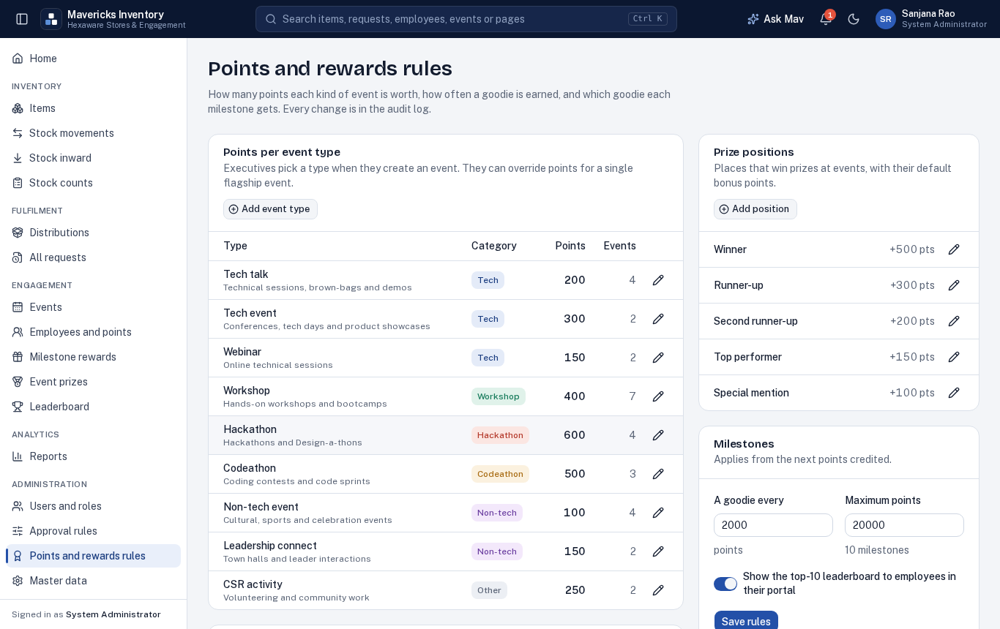

- **Points per event type:** select the pencil on a row to change its points, category or description, or to retire it (it stays on old events). **Add event type** creates a new kind of event. New points apply to attendance recorded from then on; points already given don't change.
- **Milestone goodies:** select the pencil to give a milestone a title and choose its goodie and quantity, or leave it "to be decided". The **Due now** column shows how many people are waiting for that milestone, and the stock count turns red when there isn't enough.
- **Prize positions:** the places that win prizes at events (Winner, Runner-up…) and the bonus points each gives by default. Add positions such as "Best design", change the points, or retire one.
- **Milestones:** "A goodie every 2,000 points" and "Maximum points 20,000". Change them here; the maximum must be a multiple of the step. The switch decides whether employees see the top-10 leaderboard in their portal.
- **Start a new programme year:** resets everyone's points to zero (type RESET to confirm). Rewards already earned are kept, and the reset is in everyone's points history.

### Adjust or reset points

Open a person from **Employees and points**:

- **Adjust points** adds or removes points with a reason (for example a correction, or recognition for organising an event). The dialog shows the balance before and after, and warns when the 20,000 cap limits it.
- **Reset points** sets them to zero and starts a new cycle.

Both are recorded in the person's points history and in the audit log, with your name.

### Master data

Select **Master data** to manage the lists people pick from: **Categories**, **Purposes**, **Locations** and **Units**. Type a new value and select **Add**. The switch next to a value hides it from new entries without changing old records.

### Audit log

Select **Audit log** (also available to Managers and the Management Authority). Every sign-in, change, approval, upload and export is listed with who did it and when. Where something was changed, **Show changed values** shows the before and after. Entries can't be edited or deleted.

---

### System status

**System status** (under Administration) shows whether the database is reachable, how long one database round trip takes, and where the application and the database are running. If users say the app is slow, check this page first: when the app and the database are in different regions, every page waits on several trips across the world. The page tells you exactly which region to move the app to.

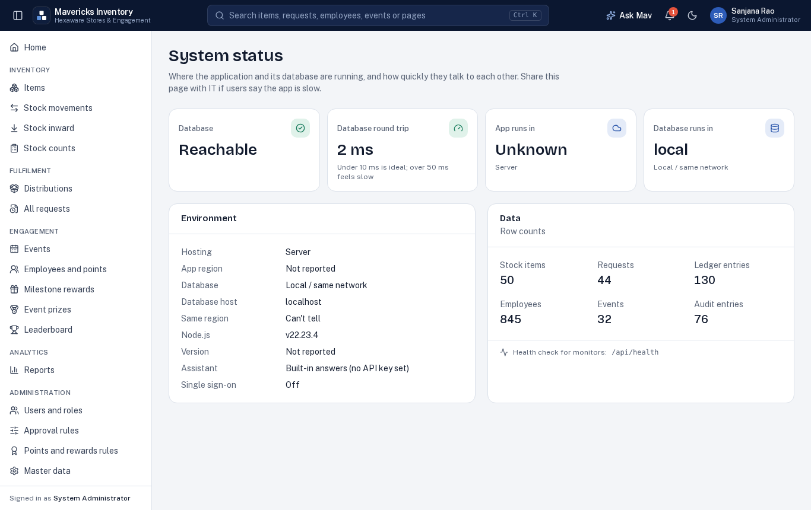

---

## For Employees: your portal

Employees sign in with their work account (or the demo **Employee** button) and see only their own information.

- **Your points** and a greeting from Mav. When you've just unlocked a reward, the gift box opens and celebrates.
- **Events attended, goodies received, rewards on the way** and **your rank**.
- **Your journey to 20,000:** the track from 0 to 20,000 with a gift at every 2,000 points. Green gifts are received, gold ones are earned and on the way, the blue ring is the next one, and the flag shows where you are.
- **Rewards:** a card for each milestone with its goodie and whether you've received it.
- **Points history:** every event and adjustment, with the balance after.
- **Coming up:** the next events and the points they give. **Top 10** (if your administrator has switched it on).
- **Goodies received** lists everything handed to you, with the date and reason. **Events** shows what's coming up and what you've attended.

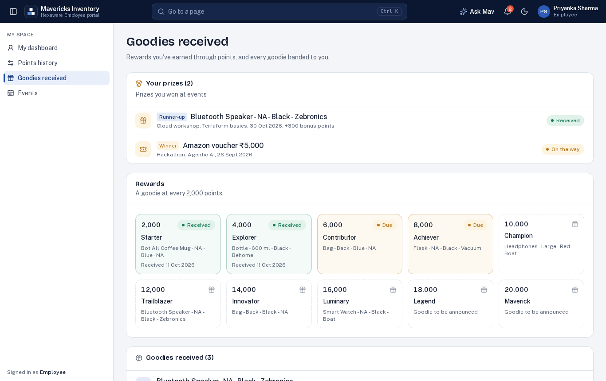

Ask Mav anything about your own points: "How many points do I have?", "What goodies have I received?", "When's the next hackathon?"

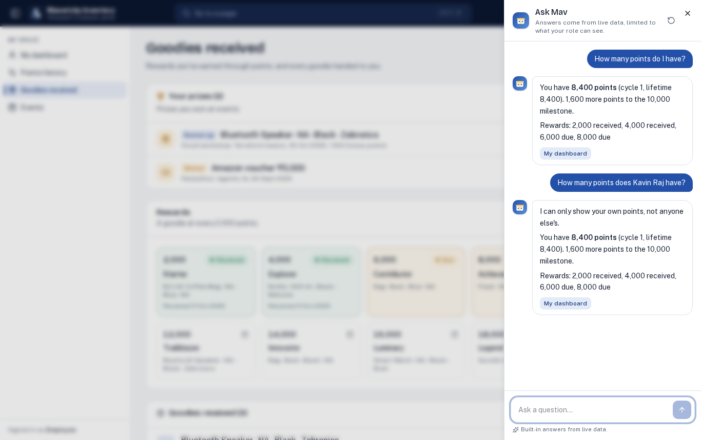

---

## Your profile and password

Open the account menu (your name, top right) → **Profile and password**.

To change your password: enter the **Current password**, a **New password** (at least 10 characters with a letter and a number) and **Confirm new password**, then select **Change password**.

**First sign-in with a one-time password:** you're taken here automatically and can't open other pages until you've chosen your own password.

---

## Questions people ask

**I recorded a distribution but the stock didn't go down.**
That's expected. Stock changes only when the request gets its final approval. Check its status under **My requests**.

**I can't see an Approve button.**
You can't approve your own requests, and at level 2 only a Management Authority who didn't approve level 1 can approve. The approval history on the request says who it's waiting for.

**The upload says "No active stock item matches this value".**
The Product Details text in that row doesn't exactly match a stock item, or the item isn't approved yet. Use the **Stock code** column instead (the template's "Stock codes" sheet lists them all), or copy the name from the Stock page.

**The upload says my file isn't valid.**
Save it as **Excel Workbook (.xlsx)**. Older .xls and .csv files aren't accepted. Files can be up to 15 MB and 50,000 rows.

**I submitted something by mistake.**
Ask the approver to **return** it; you can then fix or delete it. Approved requests can't be undone. Record a correcting request instead (for example stock inward for items that came back).

**Can I delete a stock item?**
New items in a draft can be removed. An approved item can only be deactivated by an administrator, and only if it was never used in a request, because its history must be kept.

**Where's the old Excel tracker data?**
The stock list was loaded from the Sep 25 tracker. Past handovers can be brought in by uploading the old Recipient sheet under **Distributions → Upload Excel**.

**I attended an event but my points haven't changed.**
Points are added when the executive marks attendance, usually the same day. If it's been a few days, tell the organiser your employee ID; they can add you, or the administrator can adjust your points.

**I crossed 2,000 points. When do I get my goodie?**
It appears as **On the way** in your portal. The engagement team hands rewards out in batches; once their request is approved, it shows as **Received**.

**My points stopped at 20,000.**
20,000 is the maximum. The administrator can start a new cycle for you (your points go back to zero and you can earn every milestone again).

**Someone was marked present by mistake.**
On the event page, select the minus button on their row and give a reason. Their points for that event are reversed. A reward they hadn't received yet is cancelled if they drop below its milestone.

**The app feels slow.**
Ask an administrator to open **System status**. It shows the database round trip and, if the app and database are in different regions, exactly how to fix it.

**How do I give an Amazon voucher to a hackathon winner?**
Open the event, select **Add winner**, choose **Voucher**, enter the amount and save. When you've bought and sent it, go to **Event prizes → Vouchers and other**, tick it, select **Mark issued** and enter the Amazon order number.

**Can I add next quarter's events in one go?**
Yes. **Events → Upload events**, fill the template (event name, type, date) and upload it. The events appear under Upcoming.
